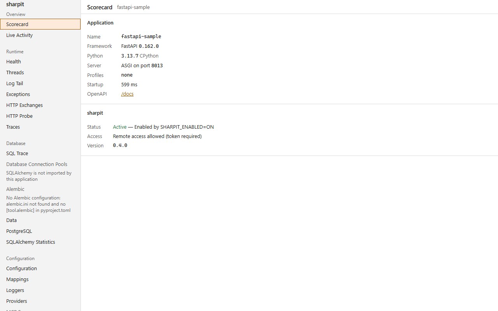

[English](https://github.com/ffroliva/sharpit/blob/main/README.md) | [简体中文](https://github.com/ffroliva/sharpit/blob/main/README.zh-CN.md)

# sharpit: developer console and pytest gate for FastAPI

[](https://sonarcloud.io/summary/overall?id=ffroliva_sharpit&branch=main)
[](https://sonarcloud.io/component_measures?id=ffroliva_sharpit&metric=coverage&branch=main)
[](https://sonarcloud.io/summary/overall?id=ffroliva_sharpit&branch=main)
[](https://sonarcloud.io/summary/overall?id=ffroliva_sharpit&branch=main)
[](https://sonarcloud.io/summary/overall?id=ffroliva_sharpit&branch=main)
[](https://sonarcloud.io/component_measures?id=ffroliva_sharpit&metric=duplicated_lines_density&branch=main)

[](https://github.com/ffroliva/sharpit/actions/workflows/ci.yml)
[](https://github.com/ffroliva/sharpit/actions/workflows/release.yml)
[](https://pypi.org/project/sharpit/)
[](https://github.com/ffroliva/sharpit/blob/main/pyproject.toml)
[](https://github.com/ffroliva/sharpit/blob/main/LICENSE)
[](https://github.com/ffroliva/sharpit/blob/main/CHANGELOG.md)
[](https://github.com/astral-sh/ruff)
[](https://github.com/microsoft/pyright)

**sharpit is an open-source developer console and pytest plugin for FastAPI and Starlette applications, with Flask
supported for test gates.** One call, `sharpit.install(app)`, mounts a local web console at `/sharpit` that shows your
configuration and where each value came from, every route, every SQL statement with the request that ran it, N+1
queries, exceptions, HTTP exchanges and health. `pytest --sharpit` turns the same capture into CI gates for N+1
queries, query budgets and swallowed exceptions. A command-line client and an MCP endpoint let scripts and AI coding
agents query the running app.

sharpit is a Python port of [BootUI](https://github.com/jdubois/boot-ui) by Julien Dubois (Apache-2.0), the Spring
Boot developer console: the same design goals, JSON contract and test cases, with a new UI. If you have used Spring
Boot Actuator or BootUI, sharpit gives a FastAPI app the same kind of runtime view.

## Quick start

1. Install sharpit and the FastAPI development server:

   ```bash
   pip install "sharpit[fastapi]" "fastapi[standard]"   # or: uv add "sharpit[fastapi]" "fastapi[standard]"
   ```

   `fastapi[standard]` provides `fastapi dev` and uvicorn. Leave it out if your project already has a server.

2. Save this as `app.py`:

   ```python
   from fastapi import FastAPI

   import sharpit

   app = FastAPI()


   @app.get("/hello")
   def hello() -> dict[str, str]:
       return {"message": "hello"}


   # Register your application middleware first, then mount sharpit:
   sharpit.install(app)  # mounts /sharpit and /sharpit/api
   ```

3. Run it with a dev signal and open <http://127.0.0.1:8000/sharpit/>:

   ```bash
   fastapi dev app.py          # or: uvicorn app:app --reload
   ```

sharpit is off unless a dev signal turns it on: `fastapi dev`, `uvicorn --reload`, a dev profile such as `APP_ENV=dev`,
or `SHARPIT_ENABLED=ON`. A plain `uvicorn app:app`, or `uvicorn.run(..., reload=True)` called from a script, answers
404 under `/sharpit`. See [Activation](https://ffroliva.github.io/sharpit/activation/).



**What you get:** 47 panels. Change a logger's level while the app runs, spot N+1 queries per route, and scan your
installed packages for known vulnerabilities when you ask for it. Every panel in light and dark:
[screenshot catalog](https://github.com/ffroliva/sharpit/blob/main/docs/screenshots.md).

**Safe to leave in your dev setup:**

- Off unless a dev signal turns it on (`fastapi dev`, `uvicorn --reload`, or a dev profile). Otherwise every path under
  `/sharpit` answers 404.
- Loopback callers only. A forwarding header never grants trust, and remote access needs a token.
- Secret-looking names and values are masked by default. Showing them takes an explicit switch
  (`SHARPIT_EXPOSE_VALUES=FULL`, or SQL parameter capture), and sharpit warns at startup when one is on.
- Reading a panel makes no network call, writes no file and changes no logger level.

**Then gate CI on it:** `pytest --sharpit` fails a test that goes over its query budget, triggers an N+1 query or
swallows an exception, and runs the REST API advisor over your routes. When capture cannot see enough to judge, the
run fails closed.

> **Status: alpha (0.9.0, FastAPI and Starlette console; Flask supported for test gates).** Django is not supported. See [CHANGELOG.md](https://github.com/ffroliva/sharpit/blob/main/CHANGELOG.md).

## Features

| Area | What sharpit shows or checks |
|---|---|
| Configuration | Every setting and the source it came from (pydantic-settings), with secrets masked |
| Routes | Every route with its handler and dependency providers; the REST API advisor |
| SQL | Every statement from SQLAlchemy (sync and async) or raw `sqlite3`, with the request that ran it; N+1 candidates per route and the slowest statement |
| Databases | PostgreSQL and MySQL panels read on request, Alembic migrations, SQLAlchemy models |
| Requests and errors | HTTP exchanges, unhandled exceptions and swallowed exceptions |
| Runtime | Health checks, connection pools, and loggers whose level you can change while the app runs |
| Security | A vulnerability scan of the installed packages when you ask for it; HTTP security headers |
| CI | `pytest --sharpit`: query budgets, N+1 queries, swallowed exceptions, baselines, JSON and JUnit reports, a GitHub Action |
| Automation | The `sharpit` command-line client with exit codes for scripts; an MCP endpoint for AI coding agents, off by default |

## When to use sharpit

| Tool | Built for | Choose it when |
|---|---|---|
| **sharpit** | A local console and pytest gates inside a FastAPI or Starlette app, in development and CI | You want to see the configuration, routes, SQL and errors of the app on your machine, and fail CI on N+1 queries, query budgets or swallowed exceptions |
| [fastapi-debug-toolbar](https://github.com/mongkok/fastapi-debug-toolbar) | A FastAPI debug toolbar based on django-debug-toolbar | You want per-request panels in the browser and do not need CI gates |
| [nplusone](https://github.com/jmcarp/nplusone) | N+1 detection for SQLAlchemy, Peewee and the Django ORM, by logging or raising | You need N+1 detection only, or you use Django |
| Logfire, Sentry, OpenTelemetry | Traces, errors and metrics from deployed services, sent to a backend | You observe production; sharpit is a development tool and stays off without a dev signal |

## Gate CI on findings

`pytest --sharpit` turns runtime capture into test gates. It tracks SQL
statements and observable exceptions per test, detects N+1 queries, checks query budgets, and runs
the REST API advisor over your app's routes. If a test exceeds its query budget, triggers an N+1 query, or swallows an
unhandled exception, the build fails. When capture cannot see enough to judge, the run status is
`unknown` and fails closed.

```bash
pytest --sharpit --sharpit-report=sharpit-report.json --sharpit-junit=sharpit-junit.xml
```

sharpit finds your app on its own: the one FastAPI, Starlette or Flask app defined in the modules your tests already imported.
It never imports a module to look. Pass `--sharpit-app module:attr` when there are several. With none, several, or one
without routes, the REST API advisor is `SKIPPED` and a clean suite still passes; `--sharpit-require-app` makes that
`unknown`. Pass `--sharpit-http-security` to gate responses against configured HTTP security headers. The terminal `gate counts:` lists only findings that fail the gate; `--sharpit-verbose` (or `-vv`)
lists every one. The JSON report and JUnit file always hold every finding.
The terminal also adds a `swallowed exceptions:` block grouped by `except` clause; a clause includes the test-double
note when a test double raised the swallowed exception.

### Adopting on an existing suite

Start without breaking the build, then freeze what is already there:

```bash
pytest --sharpit --sharpit-report-only                      # report everything, fail on nothing but blindness
pytest --sharpit --sharpit-write-baseline=sharpit-baseline.json   # after a complete run: record today's findings
pytest --sharpit --sharpit-baseline=sharpit-baseline.json         # in CI: only new findings fail
```

- **Report-only** (`--sharpit-report-only`, ini `sharpit_report_only = true`) runs every gate and advisor and writes the
  report, but findings do not fail tests or the session. An unknown reason still exits 1 unless
  `--sharpit-allow-unknown`: report-only relaxes findings, never blindness.
- **Baselines** match findings by fingerprint. A listed finding is `existing` and never fails, an unlisted one is `new`
  and gates as usual, a listed one not seen is `fixed`. A count gate that grows past its baselined count is `new`.
  Vulnerability findings are not baselined, and INFO findings never fail.
- `--sharpit-write-baseline=PATH` is the only way a baseline is written. It refuses a partial run (`-k`, `-m`, node ids,
  `--lf`, `--deselect`, `-x` stopping early, an interrupt) and a run with any unknown reason.
- A missing or malformed baseline never switches sharpit off: the session runs and the baseline becomes an unknown
  reason, which fails the run. Own the baseline file in CODEOWNERS, or a PR can baseline its own findings.

See [The safety gate](https://github.com/ffroliva/sharpit/blob/main/docs/pytest-safety-gate.md) for exit-status
behavior and the baseline workflow.

### GitHub Action

The repository root is a composite action (`action.yml`) that runs pytest with sharpit and writes a findings summary to
the job summary. Pin it to a release tag:

```yaml
- uses: ffroliva/sharpit@<release tag>
  with:
    pytest-args: "-q tests/"
    baseline: sharpit-baseline.json
```

Inputs: `pytest-args` (split with Python shlex), `report-only` (default `"true"`: findings are reported, never fail the
build), `baseline`, `fail-on` (lowest severity that fails), `report-path` (default `sharpit-report.json`), `install`
(`pip` installs the pinned sharpit; `none` when your project already depends on it, in which case `python` must be
able to import sharpit) and `runner` (default `python -m pytest`, for example `uv run pytest`). Set `report-only: "false"`
to gate. The pytest exit code is never masked: the summary step runs `if: always()` and only warns if it fails. The
summary is rendered by `python -m sharpit.report summary <report.json>`. On Windows runners `runner` and `pytest-args`
are split in non-POSIX mode so backslashes in paths survive.

### On the author's own project: gflow-cli

Run by sharpit's author with sharpit 0.6.0 from PyPI against gflow-cli's `develop` branch on 2026-11-13 (a public
FastAPI daemon using raw `sqlite3`; see [sharpit's own report](docs/reports/2026-11-13-gflow-cli-sharpit-0.6.0.md)),
sharpit ran across **6,804** tests in 3 min 21 s with `-n 4` (4 failed by sharpit gates):

- **0 unattributed SQL statements** across ~58k statements executed (25,772 attributed + 32,583 filtered);
- **0 N+1 findings** (the 0.3.0 run reported 6 N+1 findings on the suite of the time);
- **4 swallowed exceptions** fail the gate, at three places where gflow-cli's telemetry deliberately ignores a broken
  telemetry database without logging it; 114 more are reported as INFO;
- No production code was changed to get these numbers.

## Installation and extras

Python 3.12+. Runtime dependencies are only `starlette>=0.44` and `packaging>=23`.

Optional extras:

| Extra | Adds | Why |
|---|---|---|
| `sharpit[fastapi]` | `fastapi>=0.115` | the supported host |
| `sharpit[settings]` | `pydantic-settings>=2.4` | the Config panel shows which source each value came from |

The `fastapi` extra does not install a server. Add `fastapi[standard]` for `fastapi dev`, or `uvicorn`.

## Configuration and activation

Call `sharpit.install(app)` after adding your own middleware. Starlette builds middleware from the outside in, so
calling `install()` last ensures sharpit's capture middleware sits outside your application middleware. This lets sharpit
measure total request durations and record unhandled errors correctly.

Keyword arguments for `sharpit.install()`:

- `engines`: optional sequence of SQLAlchemy `Engine` or `AsyncEngine` instances to monitor in connection pools and
  health checks (e.g. `engines=[engine]`). If omitted, engines are discovered automatically on first connection.
- `health_checks`: optional mapping of check names to zero-argument callables (e.g. `health_checks={"cache": ping_cache}`).
- `alembic_config`: optional path to `alembic.ini` (default `"alembic.ini"`).
- `settings`: optional pydantic-settings instance or sequence of instances to show configuration provenance.
- `models`: optional SQLAlchemy 2.0 declarative base, registry, or a list of them or of mapped classes, for the Data
  panel (e.g. `models=Base`). sharpit never configures mappers or runs SQL to read them.

With a PostgreSQL engine, the PostgreSQL panel reads vital signs, sessions, statements, indexes, tables, vacuum,
replication and settings on an explicit `POST /sharpit/api/postgresql/read`: one read-only transaction with statement
and lock timeouts, a read budget and row limits, query text masked. `GET` returns the last read and never touches the database.

The `sqlalchemy-statistics` panel (BootUI's `hibernate-statistics`; `GET {api}/sqlalchemy-statistics`, MCP
`get_sqlalchemy_statistics`) shows statement counts from SQL Trace's lifetime totals, the slowest statement and N+1
candidates per route. SQLAlchemy reports SQL statements, not ORM sessions or entities, so the Hibernate-only counters
(sessions, flushes, transactions, entity and collection counts) are `null`, each with a reason. It needs SQL Trace, and
reports `statistics.warnings` when SQL Trace recording is paused.

Other options are keyword arguments or environment variables, see [Settings](https://ffroliva.github.io/sharpit/settings/).

If `/sharpit` answers 404, read [Activation](https://ffroliva.github.io/sharpit/activation/): sharpit stays off unless a dev signal turns it on.

## Command-line client

The `sharpit` package includes the `sharpit` console script, allowing a running application to be queried from a terminal or script without extra dependencies.

```bash
sharpit overview
```

Global options configure the connection and output format:

- `--url <url>`: application base URL (default `http://localhost:8000`, env `SHARPIT_URL`).
- `--api-path <path>`: sharpit API path (default `/sharpit/api`, env `SHARPIT_API_PATH`).
- `--token <token>`: bearer authentication token. `--token` overrides the `SHARPIT_TOKEN` environment variable; using `SHARPIT_TOKEN` is recommended so credentials are not exposed in host process listings.
- `--timeout <seconds>`: request timeout in seconds (default `60`).
- `--json`: emit raw JSON instead of human-readable text, preserving server bytes except where the token is redacted for safety. Output piped to another program is JSON without the flag.
- `--no-color`: disable ANSI colors in terminal output (also honours `NO_COLOR`).
- `-v`, `--verbose`: print verbose error details.

Commands that produce findings or evidence also take `--fail-on <severity>`, which gates the exit code on them.

Examples:

```bash
# Read application overview
sharpit overview

# Run a security scan and fail on high or critical findings
sharpit security scan --fail-on high

# Inspect runtime insights and fail if evidence is insufficient
sharpit insights list --fail-on insufficient
```

Exit codes follow BootUI 2.5.0 (`ExitCodes`):

- `0`: success (the command completed and any gate passed).
- `1`: error (network or HTTP error, invalid argument, gate cannot be evaluated); a refused MCP toggle exits 1.
- `2`: refused tool action (endpoint or panel is disabled, or a tool action is rejected by read-only policy).
- `3`: threshold (findings reached or exceeded the `--fail-on` severity, or evidence was insufficient).

## Use with an AI agent

sharpit has a read-only MCP endpoint that a coding agent can query: routes, configuration, SQL, exceptions and health of the
running app. It is off until you set `SHARPIT_MCP_ENABLED=ON`. Install the plugin and the agent gets the sharpit skill and the
connection in one step:

```
/plugin marketplace add ffroliva/sharpit        # Claude Code
/plugin install sharpit@sharpit
```

The same `plugins/sharpit` directory is listed for Cursor (`.cursor-plugin/marketplace.json`) and Codex
(`.agents/plugins/marketplace.json`). The plugin points at `http://127.0.0.1:8000/sharpit/api/mcp`; if your app listens on
another port, set `SHARPIT_MCP_URL` (Claude Code). Other clients, and what was tested, are in
[MCP for AI agents](https://ffroliva.github.io/sharpit/mcp/). For guided investigations, see the application-improvement playbooks in [`skills/sharpit/references/playbooks/`](https://github.com/ffroliva/sharpit/blob/main/skills/sharpit/references/playbooks/README.md) and the [AI agents guide](https://ffroliva.github.io/sharpit/ai-agents/).

## How close to BootUI

sharpit ports BootUI feature by feature: 0.6.0 targets BootUI 2.3.0, 0.7.0 targets BootUI 2.4.0, and 0.8.0 targets BootUI 2.5.0; 0.9.0 stays on BootUI 2.5.0 and closes recorded gaps.

| | sharpit 0.5.0 | sharpit 0.6.0 | sharpit 0.7.0 | sharpit 0.8.0 | sharpit 0.9.0 | sharpit 0.10.0 | BootUI 2.3.0 | BootUI 2.4.0 | BootUI 2.5.0 |
|---|---|---|---|---|---|---|---|---|---|
| MCP/CLI tools | 54 | 71 | 71 | 73 | 73 | 73 | 116 | 116 | 116 |
| Tools under BootUI's exact names | 45 | 62 | 62 | 64 | 64 | 64 | - | - | - |
| Panels | 31 | 48 (46 listed in the console) | 48 (46 listed in the console) | 49 (47 listed in the console) | 49 (47 listed in the console) | 49 (47 listed in the console) | 65 (Spring) | 65 (Spring) | 65 (Spring) |
| Runtime insight kinds that evaluate | none | 8 of 28 registered | 10 of 28 registered | 11 of 29 registered | 11 of 29 registered | 11 of 29 registered | 28 | 28 | 29 |
| Applicable BootUI GET fixture cases served | not measured | 33 (5 shape-identical, 28 partial) | 33 (5 shape-identical, 28 partial) | 33 (5 shape-identical, 28 partial) | 33 (5 shape-identical, 28 partial) | 41 across 38 routes (5 shape-identical, 36 partial) | 65 | not captured | 56 |

The sharpit 0.10.0 column describes the unreleased `main` branch. The increase from 33 to 41 reflects an inventory
correction for existing routes. Most cases marked `n-a` are served with fixtures that cannot establish parity.

How each row is counted, the insight kinds that evaluate, and what comes next: [ROADMAP.md](ROADMAP.md).

## FAQ

**Why does `/sharpit` answer 404?** sharpit fails closed. It turns on only for `fastapi dev`, `uvicorn --reload`, a dev
profile (`APP_ENV=dev`) or `SHARPIT_ENABLED=ON`. See [Activation](https://ffroliva.github.io/sharpit/activation/).

**Can it stay installed when the app is deployed?** It is a development tool. Without a dev signal every path under
`/sharpit` answers 404, and a `prod` or `production` profile switches it off unless `SHARPIT_ENABLED=ON` is set
explicitly. Callers are limited to loopback unless a token is configured. See the
[Safety model](https://ffroliva.github.io/sharpit/safety/).

**Which frameworks are supported?** The console runs in FastAPI and Starlette apps. The pytest gates also run against
Flask apps. Django is not supported.

**Which databases does it trace?** SQLAlchemy 2.0 (sync and async engines) and raw `sqlite3`. PostgreSQL and MySQL
engines get their own panels. See [SQL sources](https://ffroliva.github.io/sharpit/sql-sources/).

**Does it work with AI coding agents?** Yes. The MCP endpoint at `/sharpit/api/mcp` is off until
`SHARPIT_MCP_ENABLED=ON`; the `sharpit` CLI works from any agent that can run a shell command.

**How does it relate to BootUI?** sharpit is a Python port of BootUI, the Spring Boot developer console. It follows
BootUI's JSON contract and, where it has the same tool, BootUI's tool name. The intentional differences are listed in
[Deviations from BootUI](https://ffroliva.github.io/sharpit/deviations/).

## Documentation

The full documentation is at **<https://ffroliva.github.io/sharpit/>**:

- [Activation](https://ffroliva.github.io/sharpit/activation/): when sharpit turns on, and why a plain `uvicorn app:app` gives 404
- [Panels](https://ffroliva.github.io/sharpit/panels/): what each panel shows
- [Pytest plugin](https://ffroliva.github.io/sharpit/pytest-plugin/): CI gates for queries, N+1, exceptions, and advisors
- [Test report](https://ffroliva.github.io/sharpit/report/): the `sharpit-report/1` JSON schema and JUnit XML
- [SQL sources](https://ffroliva.github.io/sharpit/sql-sources/): tracing SQLAlchemy and raw `sqlite3`
- [MCP for AI agents](https://ffroliva.github.io/sharpit/mcp/): the read-only MCP endpoint and its tools
- [AI agents](https://ffroliva.github.io/sharpit/ai-agents/): improvement playbooks, CLI and MCP workflows, and runtime recipes
- [Settings](https://ffroliva.github.io/sharpit/settings/): every environment variable and `install()` keyword
- [Safety model](https://ffroliva.github.io/sharpit/safety/): local-only guard, tokens, masking, proxies and workers
- [How it works](https://ffroliva.github.io/sharpit/how-it-works/) and [Deviations from BootUI](https://ffroliva.github.io/sharpit/deviations/)

## Licence

Apache License 2.0. See [LICENSE](https://github.com/ffroliva/sharpit/blob/main/LICENSE) and [NOTICE](https://github.com/ffroliva/sharpit/blob/main/NOTICE). sharpit is derived from
[BootUI](https://github.com/jdubois/boot-ui), Copyright Julien Dubois.
