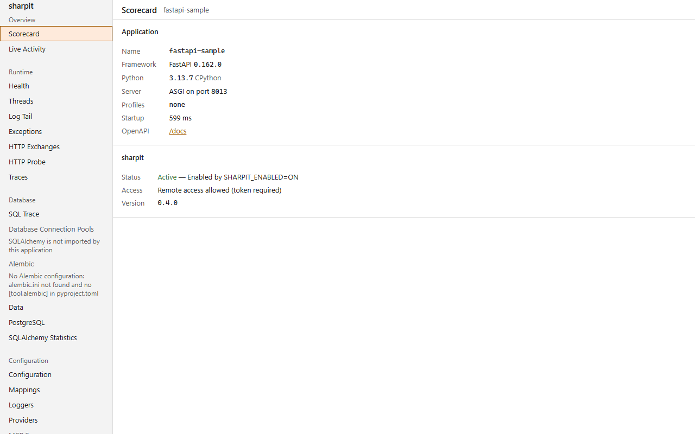

# sharpit

[](https://github.com/ffroliva/sharpit/actions/workflows/ci.yml)
[](https://github.com/ffroliva/sharpit/actions/workflows/release.yml)
[](https://pypi.org/project/sharpit/)
[](https://sonarcloud.io/summary/overall?id=ffroliva_sharpit&branch=main)
[](https://sonarcloud.io/component_measures?id=ffroliva_sharpit&metric=coverage&branch=main)

[](https://sonarcloud.io/summary/overall?id=ffroliva_sharpit&branch=main)
[](https://sonarcloud.io/summary/overall?id=ffroliva_sharpit&branch=main)
[](https://sonarcloud.io/summary/overall?id=ffroliva_sharpit&branch=main)
[](https://sonarcloud.io/component_measures?id=ffroliva_sharpit&metric=duplicated_lines_density&branch=main)

[](https://github.com/ffroliva/sharpit/blob/main/pyproject.toml)
[](https://github.com/ffroliva/sharpit/blob/main/LICENSE)
[](https://github.com/ffroliva/sharpit/blob/main/CHANGELOG.md)
[](https://github.com/astral-sh/ruff)
[](https://github.com/microsoft/pyright)

An embedded, local-only developer console and automated test gate for FastAPI apps.

## Gate CI on findings

sharpit turns runtime capture into automated test gates with `pytest --sharpit`. It tracks SQL
statements and observable exceptions per test, detects N+1 queries, checks query budgets, and runs
static analysis advisors. If a test exceeds its query budget, triggers an N+1 query, or swallows an
unhandled exception, the build fails. When capture cannot see enough to judge, the run status is
`unknown` and fails closed.

```bash
pytest --sharpit --sharpit-report=sharpit-report.json --sharpit-junit=sharpit-junit.xml
```

You no longer need `--sharpit-app` for a typical suite: sharpit picks the one FastAPI or Starlette app defined in the
project modules your tests already imported (it never imports a module to look). With none, several, or one without
routes, the REST API advisor is `SKIPPED` and a clean suite still passes; `--sharpit-require-app` makes that `unknown`
again, as in 0.3.0. The terminal `gate counts:` lists only findings that fail the gate; `--sharpit-verbose` (or `-vv`)
lists every one. The JSON report and JUnit file always hold every finding.

### Adopting on an existing suite

Start without breaking the build, then freeze what is already there:

```bash
pytest --sharpit --sharpit-report-only                      # report everything, fail on nothing but blindness
pytest --sharpit --sharpit-write-baseline=sharpit-baseline.json   # after a complete run: record today's findings
pytest --sharpit --sharpit-baseline=sharpit-baseline.json         # in CI: only new findings fail
```

- **Report-only** (`--sharpit-report-only`, ini `sharpit_report_only = true`) runs every gate and advisor and writes the
  report, but findings do not fail tests or the session. An unknown reason still exits 1 unless
  `--sharpit-allow-unknown`: report-only relaxes findings, never blindness.
- **Baselines** match findings by fingerprint. A listed finding is `existing` and never fails, an unlisted one is `new`
  and gates as usual, a listed one not seen is `fixed`. A count gate that grows past its baselined count is `new`.
  Vulnerability findings are not baselined in 0.4.0, and INFO findings never fail.
- `--sharpit-write-baseline=PATH` is the only way a baseline is written. It refuses a partial run (`-k`, `-m`, node ids,
  `--lf`, `--deselect`, `-x` stopping early, an interrupt) and a run with any unknown reason.
- A missing or malformed baseline never switches sharpit off: the session runs and the baseline becomes an unknown
  reason, which fails the run. Own the baseline file in CODEOWNERS, or a PR can baseline its own findings.

### GitHub Action

The repository root is a composite action (`action.yml`) that runs pytest with sharpit and writes a findings summary to
the job summary. Pin it to a release tag:

```yaml
- uses: ffroliva/sharpit@<release tag>
  with:
    pytest-args: "-q tests/"
    baseline: sharpit-baseline.json
```

Inputs: `pytest-args` (split with Python shlex), `report-only` (default `"true"`: findings are reported, never fail the
build), `baseline`, `fail-on` (lowest severity that fails), `report-path` (default `sharpit-report.json`), `install`
(`pip` installs the pinned sharpit; `none` when your project already depends on it, in which case `python` must be
able to import sharpit) and `runner` (default `python -m pytest`, for example `uv run pytest`). Set `report-only: "false"`
to gate. The pytest exit code is never masked: the summary step runs `if: always()` and only warns if it fails. The
summary is rendered by `python -m sharpit.report summary <report.json>`. On Windows runners `runner` and `pytest-args`
are split in non-POSIX mode so backslashes in paths survive.

### Outside proof: gflow-cli

Run by sharpit's author on the 0.3.0 integration branch against gflow-cli (a public FastAPI daemon using raw `sqlite3`; see [sharpit's own report](docs/reports/2026-11-01-gflow-cli-sharpit.md)), sharpit ran across **5,662** tests (5 failed by sharpit gates):
- **0 unattributed SQL statements** across ~53k statements executed (27,997 attributed + 25,092 filtered);
- **6 N+1 findings**, of which 1 was a real defect, 2 were noise (filtered since 0.3.0), and 3 were expected polling;
- Proved out-of-code runtime observation without changing production code.

## 60 seconds

Install sharpit with the FastAPI host extra:

```bash
pip install "sharpit[fastapi]"
# or
uv add "sharpit[fastapi]"
```

Add one call to your FastAPI app:

```python
from fastapi import FastAPI
import sharpit

app = FastAPI()

# Register your application middleware first, then mount sharpit:
sharpit.install(app)  # mounts /sharpit and /sharpit/api
```

Run tests with sharpit gate reporting:

```bash
pytest --sharpit --sharpit-report=sharpit-report.json
```

Run it locally with a dev signal and open <http://127.0.0.1:8000/sharpit/>:

```bash
fastapi dev app.py          # or: uvicorn app:app --reload
```

## Overview

One call mounts a web console at `/sharpit` and a JSON API at `/sharpit/api` inside your own app,
so a running service becomes understandable in minutes: its configuration and where each value
came from, every route, the dependency providers, loggers you can retune live, and a vulnerability
scan of the installed packages.

sharpit is a Python/FastAPI port of [BootUI](https://github.com/jdubois/boot-ui) by Julien Dubois (Apache-2.0),
the Spring Boot developer console. It ports BootUI's design goals, JSON contract and test cases; the UI is new.



> **Status: alpha (0.3.0, FastAPI only).** Django and Flask are not supported. See [CHANGELOG.md](https://github.com/ffroliva/sharpit/blob/main/CHANGELOG.md).

## Installation and extras

Python 3.12+. Runtime dependencies are only `starlette>=0.44` and `packaging>=23`.

```bash
pip install "sharpit[fastapi]"
```

Optional extras:

| Extra | Adds | Why |
|---|---|---|
| `sharpit[fastapi]` | `fastapi>=0.115` | the supported host |
| `sharpit[settings]` | `pydantic-settings>=2.4` | the Config panel shows which source each value came from |

## Configuration and activation

Call `sharpit.install(app)` after adding your own middleware. Starlette builds middleware from the outside in, so
calling `install()` last ensures sharpit's capture middleware sits outside your application middleware. This lets sharpit
measure total request durations and record unhandled errors correctly.

Keyword arguments for `sharpit.install()`:

- `engines`: optional sequence of SQLAlchemy `Engine` or `AsyncEngine` instances to monitor in connection pools and
  health checks (e.g. `engines=[engine]`). If omitted, engines are discovered automatically on first connection.
- `health_checks`: optional mapping of check names to zero-argument callables (e.g. `health_checks={"cache": ping_cache}`).
- `alembic_config`: optional path to `alembic.ini` (default `"alembic.ini"`).
- `settings`: optional pydantic-settings instance or sequence of instances to show configuration provenance.
- `models`: optional SQLAlchemy 2.0 declarative base, registry, or a list of them or of mapped classes, for the Data
  panel (e.g. `models=Base`). sharpit never configures mappers or runs SQL to read them.

With a PostgreSQL engine, the PostgreSQL panel reads vital signs, sessions, statements, indexes, tables, vacuum,
replication and settings on an explicit `POST /sharpit/api/postgresql/read`: one read-only transaction with statement
and lock timeouts, a read budget and row limits, query text masked. `GET` returns the last read and never touches the database.

The `sqlalchemy-statistics` panel (BootUI's `hibernate-statistics`; `GET {api}/sqlalchemy-statistics`, MCP
`get_sqlalchemy_statistics`) shows statement counts from SQL Trace's lifetime totals, the slowest statement and N+1
candidates per route. SQLAlchemy reports SQL statements, not ORM sessions or entities, so the Hibernate-only counters
(sessions, flushes, transactions, entity and collection counts) are `null`, each with a reason. It needs SQL Trace, and
reports `statistics.warnings` when SQL Trace recording is paused.

Other options are keyword arguments or environment variables, see [Settings](https://ffroliva.github.io/sharpit/settings/).

If `/sharpit` answers 404, read [Activation](https://ffroliva.github.io/sharpit/activation/): sharpit stays off unless a dev signal turns it on.

## Documentation

The full documentation is at **<https://ffroliva.github.io/sharpit/>**:

- [Activation](https://ffroliva.github.io/sharpit/activation/): when sharpit turns on, and why a plain `uvicorn app:app` gives 404
- [Panels](https://ffroliva.github.io/sharpit/panels/): what each panel shows
- [Pytest plugin](https://ffroliva.github.io/sharpit/pytest-plugin/): CI gates for queries, N+1, exceptions, and advisors
- [Test report](https://ffroliva.github.io/sharpit/report/): the `sharpit-report/1` JSON schema and JUnit XML
- [SQL sources](https://ffroliva.github.io/sharpit/sql-sources/): tracing SQLAlchemy and raw `sqlite3`
- [MCP for AI agents](https://ffroliva.github.io/sharpit/mcp/): the read-only MCP endpoint and its tools
- [Settings](https://ffroliva.github.io/sharpit/settings/): every environment variable and `install()` keyword
- [Safety model](https://ffroliva.github.io/sharpit/safety/): local-only guard, tokens, masking, proxies and workers
- [How it works](https://ffroliva.github.io/sharpit/how-it-works/) and [Deviations from BootUI](https://ffroliva.github.io/sharpit/deviations/)

## License

Apache License 2.0. See [LICENSE](https://github.com/ffroliva/sharpit/blob/main/LICENSE) and [NOTICE](https://github.com/ffroliva/sharpit/blob/main/NOTICE). sharpit is derived from
[BootUI](https://github.com/jdubois/boot-ui), Copyright Julien Dubois.
