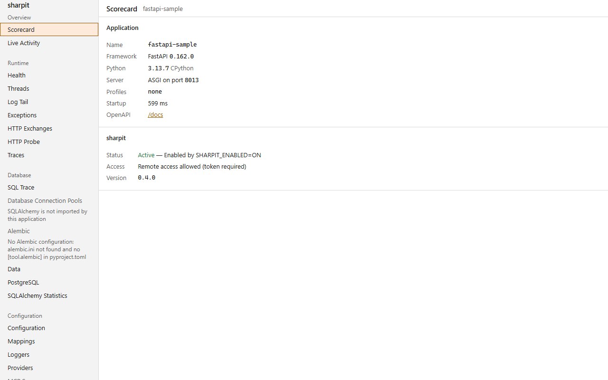

[English](README.md) | [简体中文](README.zh-CN.md)

# sharpit：默认安全的 FastAPI 开发控制台与 pytest 质量门禁

[](https://pypi.org/project/sharpit/)
[](pyproject.toml)
[](LICENSE)
[](CHANGELOG.md)

**sharpit 是一个开源的开发控制台和 pytest 插件，面向 FastAPI 与 Starlette 应用；Flask 应用可使用其测试门禁。**
只需调用一次 `sharpit.install(app)`，就会在应用内挂载一个本地 Web 控制台（`/sharpit`），集中展示：每个配置项及其来源、全部路由、每条
SQL 语句以及触发它的请求、N+1 查询、异常、HTTP 请求记录和健康状态。`pytest --sharpit` 把同样的运行时采集结果变成 CI
门禁：出现 N+1 查询、超出查询预算或异常被吞掉时，构建失败。命令行客户端和 MCP 端点则让脚本和 AI 编程助手也能查询正在运行的应用。

**安全是 sharpit 的核心，体现在两个方面。** 一方面，它本身可以放心地运行在你的应用里：默认关闭、只接受本机请求、拒绝跨站请求，
并在所有输出中对密钥脱敏。另一方面，它帮你发现应用自身的安全问题：移植自 BootUI 的安全顾问会检查认证、会话、CORS、OAuth2/JWT
和传输层配置；进程内探测会检查 HTTP 安全响应头和 CORS 预检响应；按需触发的依赖扫描会对照 OSV 漏洞库，并给出 EPSS 可利用性评分。

sharpit 是 [BootUI](https://github.com/jdubois/boot-ui)（作者 Julien Dubois，Apache-2.0）的 Python 移植版。BootUI 是
Spring Boot 的开发控制台；sharpit 沿用它的设计目标、JSON 接口约定和测试用例，界面重新实现。用过 Spring Boot Actuator
或 BootUI 的开发者，可以把 sharpit 理解为 FastAPI 上的同类工具。

## 快速开始

1. 安装 sharpit 和 FastAPI 开发服务器：

   ```bash
   pip install "sharpit[fastapi]" "fastapi[standard]"
   ```

   `fastapi[standard]` 提供 `fastapi dev` 命令和 uvicorn；项目里已有服务器的话可以省略。

   国内网络下载 PyPI 较慢时，可以使用镜像源：

   ```bash
   pip install -i https://pypi.tuna.tsinghua.edu.cn/simple "sharpit[fastapi]" "fastapi[standard]"
   # uv 用户：
   UV_DEFAULT_INDEX=https://mirrors.aliyun.com/pypi/simple/ uv add "sharpit[fastapi]" "fastapi[standard]"
   ```

2. 将以下代码保存为 `app.py`：

   ```python
   from fastapi import FastAPI

   import sharpit

   app = FastAPI()


   @app.get("/hello")
   def hello() -> dict[str, str]:
       return {"message": "hello"}


   # 先注册应用自己的中间件，最后再挂载 sharpit：
   sharpit.install(app)  # 挂载 /sharpit 和 /sharpit/api
   ```

3. 以开发模式启动，然后打开 <http://127.0.0.1:8000/sharpit/>：

   ```bash
   fastapi dev app.py          # 或者：uvicorn app:app --reload
   ```

sharpit 默认关闭，只有检测到开发模式时才会启用：`fastapi dev`、`uvicorn --reload`、开发环境配置（如 `APP_ENV=dev`），
或显式设置 `SHARPIT_ENABLED=ON`。直接运行 `uvicorn app:app`，或在脚本里调用 `uvicorn.run(..., reload=True)`，访问
`/sharpit` 都会返回 404。详见 [启用条件（Activation）](https://ffroliva.github.io/sharpit/activation/)。



**功能概览：** 共 47 个面板。可以在应用运行时调整日志级别、按路由发现 N+1 查询，并按需扫描已安装依赖包中的已知漏洞。
全部面板的浅色和深色截图见 [截图目录](docs/screenshots.md)。

> **状态：alpha（0.9.0；控制台支持 FastAPI 与 Starlette，Flask 支持测试门禁）。** 不支持 Django。更新记录见 [CHANGELOG.md](CHANGELOG.md)。

## 安全

### 为什么可以放心留在开发环境里

- 默认关闭：没有开发模式信号（`fastapi dev`、`uvicorn --reload` 或开发环境配置）时，`/sharpit` 下的所有路径都返回 404。
- 只接受本机回环地址的请求。转发类请求头（如 `X-Forwarded-For`）不会被当作可信来源；远程访问需要显式开启（`SHARPIT_ALLOW_NON_LOCALHOST` 或 `SHARPIT_TRUSTED_PROXIES`）并携带令牌。
- 所有请求方法都会拒绝跨站请求（`Sec-Fetch-Site: cross-site` 或 `Origin` 不匹配），即使应用通过 `CORSMiddleware`
  允许任意来源也一样。
- 浏览器用令牌换取 `HttpOnly; SameSite=Strict` 的会话 Cookie。开启远程访问但未设置 `SHARPIT_AUTHENTICATION_TOKEN` 时，每个进程会自动生成一个令牌。
- 看起来像密钥的配置名和值默认脱敏。要显示原值必须显式开启（`SHARPIT_EXPOSE_VALUES=FULL`，或开启 SQL 参数采集），
  开启后 sharpit 会在启动时给出警告。带用户信息的 URL（例如 DSN 里的密钥）同样会被脱敏。
- 读取面板不会发起网络请求、不会写文件，也不会修改日志级别。只有你主动触发的两个操作会联网：漏洞扫描（OSV 和 EPSS）和 GitHub 信息刷新。
- 即使上线时忘了删掉 `sharpit.install(app)`：只要环境配置是 `prod` 或 `production`，或者没有开发模式信号，sharpit
  就完全不起作用，`/sharpit` 下所有路径返回 404，也不会挂载任何监听器。这一行为有专门的测试保证。

详见 [安全模型](https://ffroliva.github.io/sharpit/safety/) 和 [安全策略](SECURITY.md)（包含私下报告漏洞的渠道）。

### 帮你检查应用的安全问题

| 面板或门禁 | 检查内容 |
|---|---|
| 安全顾问（Security advisor） | 移植自 BootUI 安全顾问的规则集：密码哈希（passlib、bcrypt 工作因子）、未启用 HTTPS 的 HTTP Basic、会话 Cookie 与密钥长度、CORS、CSRF、OAuth2 与 OpenID Connect 地址、未校验 audience 的 PyJWT 解码、可信主机与代理头、`FastAPI(debug=True)`、源码中硬编码的密钥。它只读取中间件、路由的安全方案和应用源码，不会执行其中任何代码。[规则列表](docs/security-advisor-checks.md) |
| FastAPI Security | 中间件栈以及每条路由的 `fastapi.security` 认证方案 |
| 渗透探测（Pentesting） | 在进程内探测 HTTP 安全响应头（HSTS、CSP、防嵌套、MIME 嗅探）和 CORS 预检响应，不打开任何网络连接 |
| 依赖漏洞（Vulnerabilities） | 按需将已安装的依赖包与 [OSV](https://osv.dev) 漏洞库比对，并给出 EPSS 评分 |
| `pytest --sharpit-http-security` | 检查测试通过 `sharpit_http_observed(app)` 客户端收到的响应，是否带有你为每个路由要求的响应头、状态码是否在允许范围内（`--sharpit-required-response-header`、`--sharpit-expected-status`）。[详情](https://ffroliva.github.io/sharpit/pytest-plugin/) |

## 功能一览

| 类别 | sharpit 展示或检查的内容 |
|---|---|
| 配置 | 每个配置项及其来源（pydantic-settings），密钥自动脱敏 |
| 路由 | 全部路由、对应的处理函数和依赖项；REST API 规范检查 |
| SQL | SQLAlchemy（同步与异步）或原生 `sqlite3` 执行的每条语句及触发它的请求；按路由列出 N+1 嫌疑和最慢语句 |
| 数据库 | 按需读取的 PostgreSQL 与 MySQL 面板、Alembic 迁移、SQLAlchemy 模型 |
| 请求与异常 | HTTP 请求记录、未处理异常和被吞掉的异常 |
| 运行时 | 健康检查、连接池、可在运行时调整级别的日志器 |
| 安全 | 安全顾问、按路由展示的认证方案、HTTP 安全响应头与 CORS 探测、OSV/EPSS 依赖漏洞扫描（见 [安全](#安全)） |
| CI | `pytest --sharpit`：查询预算、N+1 查询、被吞异常、基线、JSON 与 JUnit 报告、GitHub Action |
| 自动化 | 带退出码的 `sharpit` 命令行客户端；面向 AI 编程助手的 MCP 端点（默认关闭） |

## 与其他工具怎么选

| 工具 | 定位 | 适合的场景 |
|---|---|---|
| **sharpit** | 运行在 FastAPI / Starlette 应用内部的本地控制台和 pytest 门禁，用于开发和 CI | 想在本机看清应用的配置、路由、SQL 和异常，并让 CI 在出现 N+1 查询、超出查询预算或异常被吞时失败 |
| [fastapi-debug-toolbar](https://github.com/mongkok/fastapi-debug-toolbar) | 基于 django-debug-toolbar 的 FastAPI 调试工具栏 | 只需要在浏览器里查看单个请求的调试面板，不需要 CI 门禁 |
| [nplusone](https://github.com/jmcarp/nplusone) | 针对 SQLAlchemy、Peewee 和 Django ORM 的 N+1 检测，以日志或抛异常的方式提示 | 只需要 N+1 检测，或者项目使用 Django |
| Bandit、Semgrep | 对源代码做静态分析 | 需要覆盖整个代码库的安全扫描；sharpit 的安全顾问补充的是只有运行中的应用才知道的信息（中间件栈、每条路由的认证方案），并会提示项目没有配置静态分析工具 |
| pip-audit | 在命令行中对照漏洞数据库检查依赖 | 需要在 CI 里审计依赖；sharpit 额外提供 EPSS 可利用性评分，并在开发控制台中展示结果 |
| Logfire、Sentry、OpenTelemetry | 采集线上服务的链路追踪、错误和指标，发送到后端系统 | 需要观测生产环境；sharpit 是开发工具，没有开发模式信号时不会启用 |

## 在 CI 中设置门禁

```bash
pytest --sharpit --sharpit-report=sharpit-report.json --sharpit-junit=sharpit-junit.xml
```

`pytest --sharpit` 按测试用例记录 SQL 语句和可观测到的异常，检测 N+1 查询、检查查询预算，并对应用路由运行 REST API
规范检查。某个测试超出查询预算、触发 N+1 查询或吞掉了未处理异常时，构建失败。如果采集到的信息不足以做出判断，运行状态为
`unknown`，同样按失败处理（宁可误报，不放过）。

sharpit 会自动找到被测应用：即测试已经导入的模块中唯一的 FastAPI、Starlette 或 Flask 应用，它不会为了查找而额外导入模块。
存在多个应用时，用 `--sharpit-app module:attr` 指定。

在已有测试套件上逐步接入：

```bash
pytest --sharpit --sharpit-report-only                            # 只出报告，不因发现的问题而失败
pytest --sharpit --sharpit-write-baseline=sharpit-baseline.json   # 完整运行一次后，记录当前已有的问题
pytest --sharpit --sharpit-baseline=sharpit-baseline.json         # 在 CI 中：只有新增问题才会失败
```

基线、退出状态和 GitHub Action 的完整说明见 [pytest 插件文档](https://ffroliva.github.io/sharpit/pytest-plugin/) 和
[README（英文）](README.md#gate-ci-on-findings)。

## 命令行客户端

安装 sharpit 后即可使用 `sharpit` 命令，无需额外依赖，从终端或脚本查询正在运行的应用：

```bash
sharpit overview                                   # 应用总览
sharpit security scan --fail-on high               # 安全扫描，发现 high 及以上问题时失败
sharpit insights list --fail-on insufficient       # 运行时洞察，证据不足时失败
```

常用全局参数：`--url`（默认 `http://localhost:8000`，环境变量 `SHARPIT_URL`）、`--token`（建议改用环境变量
`SHARPIT_TOKEN`，避免令牌出现在进程列表里）、`--json`。退出码：`0` 成功，`1` 错误，`2` 操作被拒绝，`3` 达到
`--fail-on` 阈值。详见 [CLI 文档](https://ffroliva.github.io/sharpit/cli/)。

## 配合 AI 编程助手使用

sharpit 提供一个 MCP 端点，AI 编程助手可以通过它查询运行中应用的路由、配置、SQL、异常和健康状态。该端点默认关闭，需设置
`SHARPIT_MCP_ENABLED=ON` 才会启用。

支持 Streamable HTTP 的 MCP 客户端可以连接以下地址（已验证的客户端见下方链接）：

```text
http://127.0.0.1:8000/sharpit/api/mcp
```

不使用 MCP 的助手，也可以直接调用 `sharpit` 命令行。插件安装方式（Claude Code、Cursor、Codex）和已验证的客户端列表见
[MCP 文档](https://ffroliva.github.io/sharpit/mcp/)。

## 网络说明

- 读取面板不会访问网络。只有你主动触发的两个操作会联网：依赖漏洞扫描（访问 OSV 和 EPSS 接口）和 GitHub 信息刷新
  （访问 GitHub API）。在国内网络环境下这两个操作可能较慢或超时，失败原因会显示在操作状态里，不影响其他面板。
- 文档站点托管在 GitHub Pages（`ffroliva.github.io`）。访问较慢时，可以在本地离线查看随包附带的文档：
  `sharpit docs` 列出主题，`sharpit docs cli` 阅读某一页，`sharpit docs --search <关键词>` 全文搜索。

## 常见问题

**为什么访问 `/sharpit` 返回 404？** sharpit 默认关闭，只在 `fastapi dev`、`uvicorn --reload`、开发环境配置
（`APP_ENV=dev`）或 `SHARPIT_ENABLED=ON` 时启用。

**部署上线后还能保留吗？** sharpit 是开发工具。没有开发模式信号时，`/sharpit` 下所有路径都返回 404；环境配置为 `prod`
或 `production` 时也会关闭，除非显式设置 `SHARPIT_ENABLED=ON`。即便启用，也只接受本机请求；远程访问需要显式开启并携带令牌。详见
[安全模型](https://ffroliva.github.io/sharpit/safety/)。

**它能发现应用里的哪些安全问题？** 安全顾问会标记：弱密码哈希或明文存储、未启用 HTTPS 的 HTTP Basic 或会话 Cookie、
过短的会话密钥、过于宽松的 CORS、基于 Cookie 认证的路由缺少 CSRF 防护、使用明文 HTTP 的 OAuth2 和 OpenID Connect
地址、未校验 audience 的 PyJWT 解码、`FastAPI(debug=True)`、缺少 `TrustedHostMiddleware` 以及硬编码的密钥。渗透探测面板检查响应实际携带的安全响应头，
依赖漏洞扫描检查已安装的依赖包。详见 [安全顾问规则](docs/security-advisor-checks.md)。

**支持哪些框架？** 控制台支持 FastAPI 和 Starlette；pytest 门禁还支持 Flask。不支持 Django。

**能追踪哪些数据库？** SQLAlchemy 2.0（同步与异步引擎）和原生 `sqlite3`；PostgreSQL 和 MySQL 另有专门面板。

**遇到问题去哪里反馈？** 请在 [GitHub Issues](https://github.com/ffroliva/sharpit/issues) 提交。

## 文档

完整文档（英文）：**<https://ffroliva.github.io/sharpit/>**，包括
[启用条件](https://ffroliva.github.io/sharpit/activation/)、[面板说明](https://ffroliva.github.io/sharpit/panels/)、
[pytest 插件](https://ffroliva.github.io/sharpit/pytest-plugin/)、[配置项](https://ffroliva.github.io/sharpit/settings/)、
[安全模型](https://ffroliva.github.io/sharpit/safety/) 和 [与 BootUI 的差异](https://ffroliva.github.io/sharpit/deviations/)。

## 许可证

Apache License 2.0，见 [LICENSE](LICENSE) 和 [NOTICE](NOTICE)。sharpit 源自 [BootUI](https://github.com/jdubois/boot-ui)，
版权归 Julien Dubois 所有。
